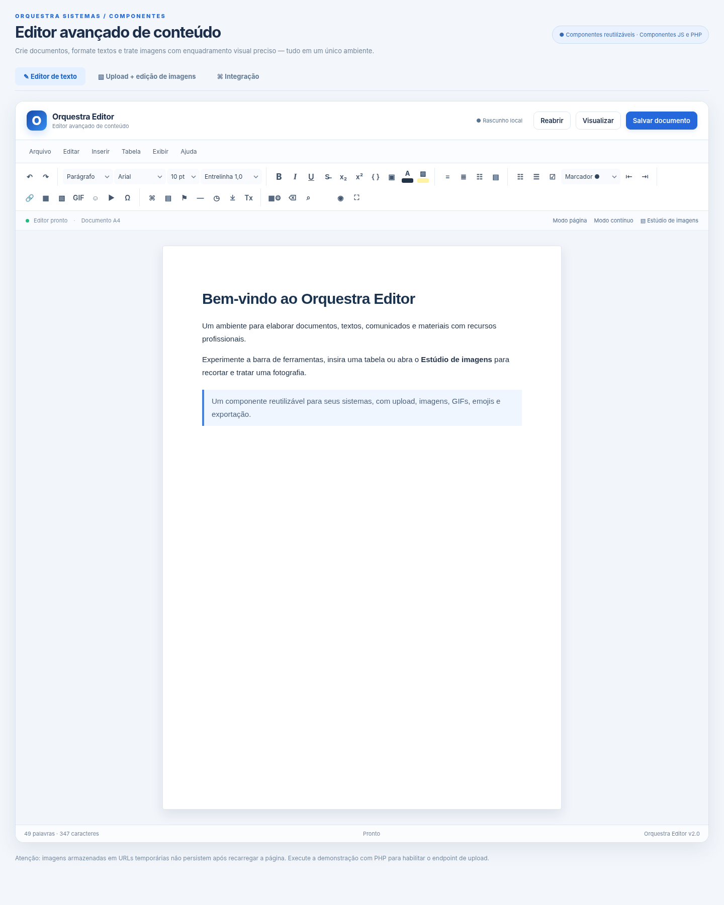
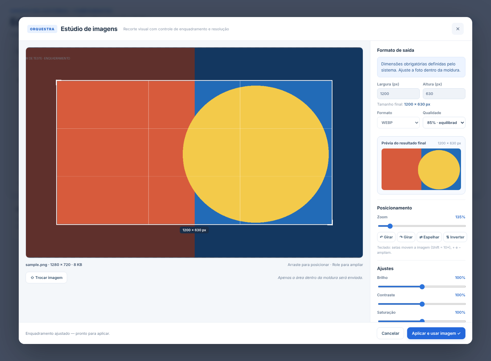

# Orquestra Editor 2.0

**Editor web WYSIWYG + estúdio de imagens independente, com recorte obrigatório e perfis de tamanho administrados pelo desenvolvedor.**

> **Status:** versão funcional de referência, sob evolução. Repositório inicialmente **privado**. Não é uma cópia ou implementação completa do CKEditor 5, TinyMCE ou Jodit. O motor usa `contenteditable`/`execCommand` (legado); consulte [Arquitetura](docs/ARQUITETURA.md) e [Roadmap](docs/ROADMAP.md) antes de aplicações com requisitos elevados de fidelidade documental.





## Dois componentes

| Componente | Responsabilidade |
|---|---|
| `OrquestraEditor` | Editor de conteúdo HTML, formatação, tabelas, imagens, links, emojis, GIFs, vídeos, código-fonte HTML, modelos, preview, salvamento e reabertura |
| `OrquestraImageUploader` | Upload independente, prévia do corte, dimensões fixas por parâmetro, zoom, enquadramento, filtros, exportação e envio ao servidor |
| `ImageStudio` | Editor de imagem usado internamente pelos outros componentes ou diretamente em formulários |

Sem dependências JavaScript obrigatórias e sem build para executar a demonstração. Backend demonstrativo em **PHP 8.2+**. Navegador moderno com ES Modules, Canvas 2D, ResizeObserver e Blob.

## Experimente em menos de um minuto

```bash
php -S 127.0.0.1:8080 -t .
```

Acesse `http://127.0.0.1:8080/`. O PHP de exemplo permite requisições **somente do loopback** quando não houver token configurado.

## Exemplos executáveis

- [Upload fixo com enquadramento obrigatório](examples/uploader-fixo.html)
- [Editor HTML: salvar, exportar e reabrir](examples/editor-html.html)

Execute esses exemplos pelo mesmo servidor PHP local.

## 1. Editor HTML

```html
<link rel="stylesheet" href="/orquestra/src/styles.css">
<div id="editor"></div>
<script type="module">
  import { OrquestraEditor } from '/orquestra/src/editor.js';
  const editor = new OrquestraEditor('#editor', {
    id: 'contrato-2026-001',
    autosave: true,
    initialHTML: '<h1>Contrato</h1><p>Texto inicial.</p>',
    uploadUrl: '/orquestra/backend/upload.php',
    saveUrl: '/orquestra/backend/save-document.php',
    onChange: html => console.log('Alteração em HTML', html),
    onSave: html => console.log('HTML persistido', html)
  });
  // Exportação explícita do fragmento HTML:
  window.getDocumentoHTML = () => editor.getHTML();
  // Reabertura do documento remoto:
  window.reabrirDocumento = () => editor.load();
</script>
```

**Contrato de persistência:** `getHTML()` devolve **fragmento HTML sanitizado**. `setHTML(html)` carrega HTML salvo preservando as tags e estilos permitidos. `getDocumentHTML()` devolve uma página HTML completa com CSS básico embutido; use o fragmento no banco e o documento completo apenas para exportação. O endpoint PHP armazena o HTML como dado JSON, nunca o executa. Leia [Persistência HTML](docs/HTML-PERSISTENCIA.md).

## 2. Upload de imagem com perfil fixo

```html
<div id="banner-upload"></div>
<script type="module">
  import { OrquestraImageUploader } from '/orquestra/src/image-studio.js';
  const uploader = new OrquestraImageUploader({
    element: '#banner-upload',
    width: 1200,
    height: 630,
    locked: true,              // usuário não altera dimensões nem proporção
    requireAdjustment: true,   // obriga interagir com enquadramento
    allowGIF: false,           // recorte animado não está implementado
    allowUpscale: true,
    format: 'image/webp',
    lockFormat: true,
    quality: 85,
    profile: 'banner-site',    // servidor confere 1200 × 630 + WEBP
    uploadUrl: '/orquestra/backend/upload.php',
    onUpload: ({url,width,height,blob}) => console.log(url,width,height,blob)
  });
</script>
```

O usuário vê a foto inteira com a parte externa ao recorte escurecida, uma **prévia real do resultado** em miniatura, ajustes de zoom, posicionamento, rotação, filtros e botão de aplicar. Com `requireAdjustment:true`, a confirmação só é habilitada após uma ação de edição; o usuário não pode alterar `width` nem `height` quando `locked:true`.

> **Importante:** bloquear dimensões no navegador não garante segurança. O parâmetro `profile` aciona a conferência no servidor de largura, altura e MIME. Configure os mesmos valores no PHP ou em `ORQUESTRA_IMAGE_PROFILES_JSON`.

## 3. Usar o estúdio diretamente

```js
import { ImageStudio } from './src/image-studio.js';
const studio = new ImageStudio({ maxBytes: 15 * 1024 * 1024 });
const result = await studio.open(fileSelecionado, {
  width: 400, height: 400, locked: true, requireAdjustment: true,
  format: 'image/webp', lockFormat: true, quality: 85
});
if(result) {
  // result.blob, result.width, result.height, result.name, result.animated
  const body = new FormData();
  body.append('file', result.blob, result.name);
}
```

## Funcionalidades implementadas

Editor: menu Arquivo/Editar/Inserir/Tabela/Exibir/Ajuda; negrito, itálico, sublinhado, tachado, subscrito, sobrescrito, fontes, cores, tamanhos, entrelinha, alinhamentos, recuos, listas ordenadas/não ordenadas, estilo de listas, bloco de código, destaque, modelos de ofício/ata/comunicado/contrato, data e hora, caracteres especiais, emojis, inserção de GIF, upload/corte de imagem, links, tabelas, inserção/remoção de linhas/colunas, propriedades, mescla/split horizontal simples, âncoras, visualização, fonte HTML, busca/substituição, fullscreen, somente leitura, contador de palavras/caracteres, exportação HTML/TXT e impressão pelo navegador, autosave local e recuperação remota.

Imagens: upload arrastar/soltar, formato JPEG/PNG/WEBP, enquadramento cover, área descartada escurecida, preview, zoom, arrastar, girar, espelhar, contraste/brilho/saturação, filtros, formato e qualidade de saída, tamanho fixo/alterável por configuração. GIF animado preservado quando usado fora de perfil fixo, sem corte.

**Não implementado:** coedição em tempo real, track changes, comentários colaborativos, importação DOCX fiel, exportação DOCX nativa, paginação automática de múltiplas folhas, editor semântico ProseMirror e tratamento de quadros de GIF. Para essas necessidades, veja o [Roadmap](docs/ROADMAP.md).

## Documentação

- [API de JavaScript e eventos](docs/API.md)
- [Configuração do uploader e perfis fixos](docs/CONFIGURACAO.md)
- [Persistência e reabertura em HTML](docs/HTML-PERSISTENCIA.md)
- [Segurança e hospedagem em produção](docs/SEGURANCA.md)
- [Arquitetura e limitações técnicas](docs/ARQUITETURA.md)
- [Testes e integração contínua](docs/TESTES.md)
- [Matriz funcional e cobertura](MATRIZ_FUNCIONAL.md)
- [Evoluções planejadas](docs/ROADMAP.md)
- [Referências da documentação oficial](docs/REFERENCIAS.md)
- [Preparação de repositório GitHub privado](docs/GITHUB.md)

## Testes

```bash
pip install -r tests/requirements.txt
python -m playwright install chromium
php -S 127.0.0.1:8765 -t .  # terminal 1
python tests/smoke.py         # terminal 2
```

Os testes cobrem persistência HTTP em PHP, validação do perfil no servidor, formatação HTML, sanitização, corte real em Canvas, arquivo animado, limites de configuração e interface móvel. Não representam auditoria de segurança ou compatibilidade total em todos os navegadores.

## Licença e publicação

O projeto está em preparação para publicação. Consulte [LICENSE.md](LICENSE.md). **Não está liberado para redistribuição pública até definição de uma licença**. Referências a outros editores servem apenas para análise de funcionalidades; não usamos suas marcas como endosso.

---

**Coordenação do projeto**  
Camargo Felis Guedes  
CRC/ES 22.562/O